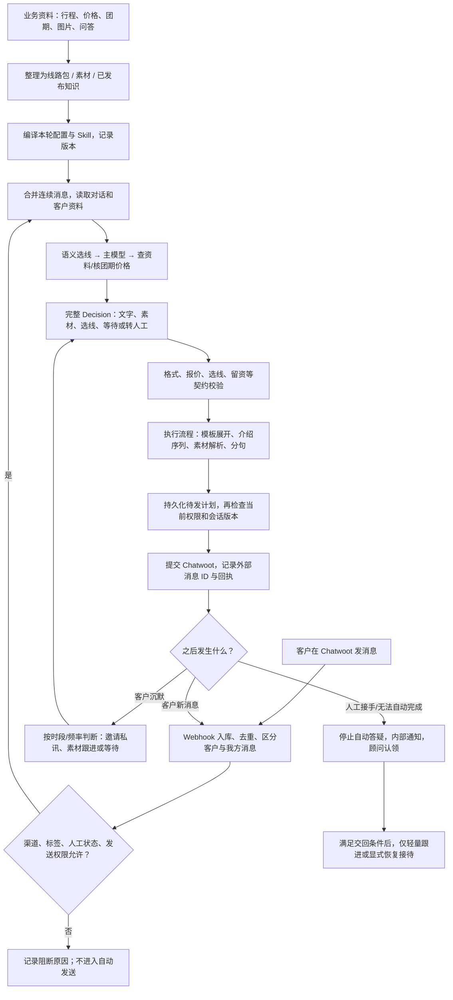

# 当前 AI 接待系统全流程说明与审计（2026-11-01）

本文按“准备一条线路 → 发布并启用 → 客户进来 → 模型判断 → 执行和发送 → 跟进 → 人工接手”的顺序说明当前系统。以实际 V3 代码和本次线上只读快照为准；历史 V1/V2 文档、数据库中遗留的旧表，以及界面上能保存的字段，都不能直接当作当前行为。

贯穿示例：**西藏桃花＋珠峰 11 日，线路 ID `peach_11d_2027`**。本文把“已经运行的行为”“本次修复”“存在的问题”“建议后续调整”分别标明，不将建议当成已实现。

## 0. 先交代 #511 的问题和本次修复

会话 #511 的客户问“11日價位”。运行记录 3971 中，主模型实际上生成了包含价格的句子：

> 2027桃花＋珠峰11日的出發區間是3/20–4/10，團費標準是人民幣12,780元/人（兩人一房）。

随后第二次模型调用做“重复内容检查”，把这整句标为重复；程序按照句子编号删除它，剩下包含、不含等内容。**客户问的价格在发送之前被删了。**问题不是主模型没有回答，也不是 Chatwoot 丢了这句。

设计上的错误是：把“减少重复表达”的辅助判断，直接变成对客户答案的逐句删除权限。一个句子可能同时包含重复日期和第一次出现的价格，删除整句会破坏完整回答。此前只保护带金额的句子，也不能解决非金额答案被删的问题。

本次已经实施并上线：

1. 客户主动消息、介绍结束后补答、人数询问结束等答疑事件，**完全不调用重复检查模型**，不是增加一个金额例外。
2. 删除原来实际执行逐句裁剪的 `trim()`。
3. 只在客户没有新发言的 `silence_due` 定时跟进中保留可选的发送判断：通过则保留整条，不适合则整次等待；不再删掉一部分再发送剩余内容。整次跳过也包括它附带的图片和模板。
4. 跟进检查超时或格式错误，延后这次可选触达，不发送残片。
5. 跟进被跳过后，不再触发“必须邀私讯”的二次校验错误，也不重新启动人数询问、大团介绍或保存本次未传达的选线变更。

重复检查仍有兼容字段名 `remove_clause_ids`，但现在只记录“不适合发送”的证据；**字段名称不代表仍然按编号删除句子**。后续可以重命名协议，但不影响这次修复。

上线证据：

| 项目 | 核对结果 |
|---|---|
| 首次移除删句的提交 | `62ea221` |
| 补充修复提交 / 当前运行代码提交 | `eee6705d895f0696a3719d5a63a44b528cf4b4b1` |
| 最后部署时间 | 2026-11-01 11:08:02，中国时间 |
| 发布目录名 | `answer-integrity-20261101T030324Z` |
| 实际加载引擎 | `reception-v3-f00fe83fbf5f53a2` |
| 业务配置摘要 | `9295297e105f160d40abe23af6b901f4b56623561e43f2797038bf2317b2f3a5`，本次未修改业务配置 |
| 本地回归 | 260 项通过；一项已有依赖弃用警告 |
| Linux 隔离预检 | 172 项通过，网络禁止，不能向客户发送 |
| 线上核验 | 五个服务 active；公开健康检查 HTTP 200；加载代码的主动答疑绕过、跟进整次处理、完整邀请及分句检查通过 |
| 备份 | `/opt/china2go-ai/backups/answer-integrity-20261101T030324Z`，本次改动代码备份 |
| 数据边界 | 未改客户状态、渠道开关、价格、通知名单；未补发历史回复；无真实客户测试消息 |

**验证范围必须讲清楚：**这次是针对执行机制的确定性回归与线上加载核验，没有新增付费模型测试。核验快照中发布后尚无新的真实接待运行，因此不能声称已经用发布后的真实客户对话证明了所有回复质量。本文后面列出的其他内容改写/流程覆盖也并未因此自动消失。

回归覆盖了 #511 的“日期与首次报价在同一句”原始模式、主动/补答事件绕过检查、审核开关和人工跟进标志组合、非法审核回执、超时、整次跳过时不留下孤立图片、不保存未传达选线，以及次日联系邀请被跳过后的正常排程。其他相关回归包括人数价、季节团期、选线、7 人以上、人数询问、顾问交回和留资。

## 1. 先看整条链路

系统不是“客户文字直接丢给一个模型，再原样发出去”。现在由模型负责语义理解与回复计划，程序负责资料装配、业务工具、流程执行及发送。**程序也确实还会覆盖部分回复计划、改少量措辞。**这些作用点见第 6 节，不能省略。

## 2. 一条线路上线前，到底要准备什么

以桃花 11 日为例，业务交付最好是一份相互一致的资料包，不能仅提供一张行程长图。

| 资料 | 应提供的内容 | 系统落点 | AI 怎么使用 / 怎样才生效 |
|---|---|---|---|
| 产品身份 | 稳定线路 ID、名称、年份、天数、进出城市、广告按钮文字、常见称呼 | 线路包的名称、标题、别名、入口文字 | 进入启用目录后用于语义识别；同名不同版本需明确区分 |
| 行程事实 | 每天安排、是否上珠峰、酒店/车/供氧、包含与不含、已确认的车程说明 | `knowledge_facts` | 作为回答依据；当前所有启用线路的事实都会给主模型，供比较和答疑 |
| 团期规则 | 年份、起止日、星期、例外日、办理提前期、包团可选日期条件 | `departure_availability` 或 `seasonal_pricing` | 由日期工具计算，不能只靠写进普通段落来改变工具结果 |
| 价格规则 | 币种、原价、人数档位、每人优惠、包团附加价、房差、有效期、特价例外 | `party_pricing`、季节价格、报价模板 | 程序核算并生成受约束模板；业务文案里的数字不能替代结构化价格 |
| 首轮介绍 | 先发什么图、每组配文、顺序、哪些组参加首轮、发送间隔 | `content_groups`、`content_sequence`、`initial_delivery` | 执行器按启用组展开，通常使用配置文字和图片 |
| 常见问答 | 适用/不适用场景、答案、关联图片、启用状态 | `fixed_answers` | 模型选择使用；非价格问答并非一律逐字锁死，详见第 6 节 |
| 图片/文件 | 实际原文件、用途、对应线路、图片内容说明、季节限制 | `StoredMedia`、`MaterialAsset` 和素材叙述 | 文件必须存在且绑定正确；AI 通常看素材的描述和标识，不是每轮重新阅读所有产品图片 |
| 沉默跟进 | 适用线路/标签、场景、文字、候选图片、是否启用 | 全局接待配置 `material_rules` | 先筛选可用规则，再让模型决定本轮要不要用；上传一张图不等于会被跟进发送 |
| 特殊接待 | 7 人以上、独团、拒绝某景点、介绍完交顾问等 | 线路 `large_party`、专属 Skill、通用规则 | 已有结构可配置；全新流程类型仍需代码支持和测试 |
| 通用服务 | 入藏办理、合同、保险、高反应对、绒布住宿说明、联系渠道 | 服务知识、通用话术、已发布网站知识 | 跨线路共用；必须明确条件，不能将通用说明当作该客人的实时房态 |
| 资料来源 | 文件名/页签/单元格、业务确认日期、版本、生效范围 | `source_ref`、版本字段、发布记录 | 用于追溯；“有来源”不等于系统会自动刷新原文件 |

Excel、ZIP、网页是业务原始输入，不是模型自动训练数据。当前运行时主要读取已经整理的 JSON、数据库记录和 Skill 文本。只把 Excel 放进目录、在聊天里发一个 ZIP、修改网站文章，都不能保证正式回复立刻变化。

客户自己发来的图片是另一条链：当前视觉识别与已知点赞贴图识别均开启，只读取本轮客户附件，最多 4 张、单张最多 8MB，并限制下载域名、格式和跳转。图片不可读时降级承接已有文字，不能假装看见。当前这条链没有等价的通用语音转写或任意文件解析能力。

### 桃花 11 日当前实际资料

当前线路包版本为 `2026-10-27.audit-priority-v1+large-party-20261027`，核心值是：

- 2027 年，出发区间 3/20–4/10；普通公布出发星期为周五、六、日、一；办理提前期 30 天。
- 4 人起独团可以进入自行选日期的判断，但仍需在公布经营区间内，不能据此保证任意日期、价格及房态。
- 基础价 12,780 元/人；4–5 人每人减 200，6–7 人每人减 400，8–9 人每人减 600，以此类推。
- 独团附加价单列：当前有 4 人每人加 400、6 人加 0；**没有 5 人独团附加价，不能自行补成 0。**
- 自动人数报价上限为 6；7 人以上进入专属介绍和顾问流程。优惠公式可以继续算，不代表 AI 获准自动向 7 人以上报价。
- 新报价模板只展示最终每人价、包含和不含，不展示早鸟文案。
- 首轮介绍序列包含顾问开场、行程图、桃花亮点、住宿/绒布、文化、车辆供氧、住宿总结、无购物等 11 个组；实际还受组启用、图片去重、季节和会话状态影响。
- 客户同时点桃花 9 日与 11 日时，有配置的比较关系：先展示较完整的 11 日，再简述珠峰差 2 天。这是这对线路的规则，不能泛化为所有 10 日/8 日都“只差珠峰”。

因此，要纠正报价，应改价格来源；要纠正产品事实，应改事实；要调整发图顺序，应改内容组。三者不是同一个编辑框。

## 3. 资料怎样发布，怎样进入本轮 AI

### 3.1 线路包的版本选择

代码同时读取仓库自带的 `data/knowledge/china2go/route-packages` 和服务器运行时的 `backend/data/route-packages`。同一路线按 `package_version` 的**字符串顺序**选择较大者；版本相同时，后读取的运行时目录胜出。

这不是按文件修改时间取最新，也不是运行时目录无条件优先。版本字符串起名错误，可能出现文件已经改了，但加载的仍然是另一份。注册表会依据文件路径、mtime、size 变化重新加载；线路包结构、知识版本不合法则不能正常启用。

当前线路内容编辑接口 `PUT /automation/route-products/{route}/content` 保存后直接安装运行时版本。线路导入接口 `POST /automation/route-products/import` 也会校验、安装并加入启用目录，**目前不是完整的“草稿 → 预览 → 审批发布”体系**。导入会检查引用素材、知识版本和大小等条件。

新增路线还需要对应 `backend/app/reception_v3/skills/<线路名>/SKILL.md`。注册表按目录扫描 Skill，不会因导入一份 JSON 自动生成新 Skill。所以“新增任意产品完全不用开发”目前不成立。阿里系列不在本次线上启用的六条目录中，不能把业务已经交资料等同于已进入正式 AI 接待。

### 3.2 网站知识有另一套发布机制

网站先抓取、解析成版本和知识模块，审核后发布；运行时要求来源 active、AI 启用、存在有效已发布版本，且正式环境只读 `live` 范围。发布到 `playground` 不会自动进入线上。

本次快照中，官网全局知识来源 ID 1 的已发布与最新版本均为 4，范围为 live。运行代码不是每问一次就重新浏览网站，也不是自动把网页价格写入报价工具。

当前接待调用 `active_web_facts(..., candidate_pool=True)`：把符合发布范围的模块事实组成候选池，按关联度排序，交给模型使用。**这一入口没有使用默认“仅取 4 条”的裁剪。**来源上的 `match_keywords` 也不是强制触发开关；代码计算了来源词重合度，但没有将其加入最终评分。因此，仅改“网站匹配关键词”不能保证回答时一定引用某篇文章。

### 3.3 每轮编译，而不是改完就永久记进模型

`compile_skills()` 将当前启用线路、接待设置、通用服务知识、有效话术和素材规则编成一个本轮资料包，记录 digest。Skill 加载时再附上这份配置，主模型据此判断。

主要装配规则：

1. 只有 `enabled_route_variants` 中的线路进入本轮目录。
2. 通用服务文件提供基础问答；后台同 ID 的通用话术覆盖它，包括“禁用”覆盖。
3. 线路只编入 active 的固定问答，内容组是否参加首轮还看 `initial_delivery`。
4. 启用人数报价时，程序重建对应报价脚本，覆盖旧 `price*` 脚本，并调整旧价格内容组。单改旧报价文本可能被重新生成的内容覆盖。
5. 部分报价有固定首次报价日期和期限：同一客人的期限不能每次重算延长；过期切换标准价。历史有效承诺与新客报价分开处理。
6. 通用 Skill 和当前线路 Skill 预先加载；模型选到新线路时，需加载该线路 Skill，再完成这一轮决定。
7. 每轮附带所有启用线路的简短事实；并不是每条线路的全部图文和完整话术都无差别塞进主提示词。

模型参数变化、代码提示词变化、业务配置变化是三个不同版本维度。配置 digest 相同，不代表引擎没有改；本次即属于代码引擎改变而业务配置不变。

## 4. 客户消息进来：先决定有没有资格接待

### 4.1 接收与身份

Chatwoot 通过 `/v1/webhooks/chatwoot/{connection_key}` 发事件。接口检查连接标识、账号、JSON 和体积，先落入 `webhook_events`，返回 202。创建事件按账号、类型、资源 ID 去重；更新类事件另外纳入内容哈希，避免把真正的状态更新当作重复。

202 只表示接收成功，不表示模型完成，也不表示客户收到回复。该入口代码依靠连接路径密钥和账号校验，不能把它描述为另有已实现的 Webhook 签名验证。

后续区分 incoming（客户）、outgoing（我方）及 activity（系统活动），私有备注和外部 echo 不作为客户新问题。**顾问身份不是靠名字里有没有“顾问”、也不是把每条最新消息都当客户。**

AI 也可能通过同一个 Chatwoot 用户账号发消息，因此 AI/人工区分首先依据本系统保存的外部消息 ID 与 `OutboundMessage`。若回调比发送 API 回执先到，会暂缓归属判断、阻止抢答并做对账；不能一看到这个账号的 outgoing 就断言是人工。无法确认归属时进入异常处理，不能猜测后重发。

历史同步采用分页，检查消息 ID 和游标是否推进，最多 250 页。未完整取到历史会明确失败/退避，不能假装历史为空重新开场。历史镜像、接待会话、待发队列分别保存，不能仅看 Chatwoot 页面判断程序处于哪一步。

### 4.2 开关并非只有一个

自动接待需同时满足：运行模式和发送总闸、租户 AI、收件箱状态与 AI 开关、接待收件箱范围、会话白名单（若启用）、回复策略、AI/人工标签及同步状态、Chatwoot `can_reply`、发送失败阻断、人工接管/待认领任务等条件。

人工保护也会检查同一联系人、同一收件箱中的其他有关会话，避免在另一条会话已有顾问处理中时抢回接待。这些限制会在模型执行/应用阶段和真正发送前再次检查，防止顾问刚接手，旧答案仍发出去。

截至本次核验，渠道实际组合为：

| Chatwoot 收件箱 | 绑定 AI | 在接待范围 | 状态 | 渠道组合开关 |
|---|---:|---:|---|---|
| 128853 · china2go | 关 | 是 | active | 关 |
| 128859 · CITS 國旅環球 - China2Go | 关 | 是 | inactive | 关 |
| 142196 · CITS China2Go｜Global Travel | 开 | 是 | active | **开** |
| 150774 · China2Go-CITS中國國旅環球 | 开 | 否 | active | 关 |
| 150781 · line@china2Go | 开 | 否 | active | 关 |

全局发送总闸当前为开。上表的“开”仍不意味着每条会话都能回答，后面还有人工、标签及渠道权限条件。本次没有自动更改这些渠道状态。

**新串联粉专不等于自动开机器人。**同步新收件箱时基础 AI 字段默认可为 true，但仍需进入正式接待范围及满足其他条件。现有“系统设置 → 渠道 AI”页面使用组合状态，并在保存时同步相关范围配置；旧页面只看基础字段，容易造成误解。

此外，自动给新客启用 AI 有启用日期和会话新旧限制。本次配置起点为 2026-10-04 04:15:24 UTC；它不是给所有历史会话补 AI 标签的任务。手动加 AI 标签后的恢复也另有判断，见第 9 节。

### 4.3 连续消息、旧答案和首轮提问

当前默认把短时间连续消息合并：等待 2 秒，最长 5 秒；积压超过 300 秒的消息有超时处理，不当作刚发生的新消息盲目重放。

每条新客户消息增加会话 generation，取消未发的沉默跟进，加入待答问题。旧模型结果若完成时 generation 已变，不能覆盖新状态。介绍期间客户补月份或人数，也会暂停相关待发内容，重新检查路线和日期。

第一轮目前仍有程序化的开场/人数询问：启用 intake 时可先发配置问题和选项，当前等待上限 90 秒；这并非所有客人都先获得一条完全自由生成的回答。准确广告入口、同时点两条产品卡及自由文本走的路径也不同。

## 5. AI 实际拿到什么，哪些判断交给模型

### 5.1 本轮上下文

主模型收到以下几类信息：

- 当前事件：客户新消息、介绍完成、人数询问到期、定时跟进等。
- 对话历史：客户消息，以及已提交/发送/送达/已读的我方消息；不把取消草稿当成已经说过。
- 本轮连续输入、尚未回答的问题、近期我方表达，提醒模型衔接而非重讲产品。
- 客户档案：人数或人数范围、出行时间、拼/包团意向、候选/已选路线、留资状态、拒绝项等。
- 当前流程状态：是否介绍中、哪些图文已发、是否等人数、是否人工跟进模式、下一跟进时点。
- 线路目录、线路事实、已加载 Skill、报价证据、通用服务知识和已发布网站事实。
- 可用素材的名称、用途、线路、标识及叙述；本轮满足条件的素材规则。
- 在需要次日优先留资时，附加有真实历史消息 ID 的审核任务。

普通主接待历史并不是统一只保留最近 24 条。24 条是前置语义识别、顾问跟进等子任务的局部窗口；主接待当前会把服务层收集的可见历史交给模型。会话越长，成本和上下文竞争可能越大。

代码有输入长度上限：超过 `deepseek_max_input_characters` 时抛出 `v3_context_too_large`，不是自动摘要。该参数代码默认 300,000 字符；本文未把默认值冒充为另行核对过的线上覆盖值。

### 5.2 可能不止一次模型调用

当前文字主模型为 `deepseek-v4-flash`。客户视觉消息使用另外配置的 `deepseek-flash`；这两项已分别核对，不能假定同名。前置语义识别开启，专用模型字段为空，沿用主模型。

正常链路可能包括：

1. **前置语义识别**：判断询问、选中、比较、拒绝、确认、含糊等，并给原话证据。询问某线路，不直接等同于决定换线；含糊时可以先返回澄清，而不再跑主答复。
2. **主模型接待**：理解问题、决定说什么、是否介绍/查价/留资/等待/交顾问。
3. **工具往返**：模型请求加载资料或核团期，拿到结果后继续组织答案。
4. **完整决定的校验及必要重试**：路线证据、日期、报价、素材、留资等不合约时，将明确问题反馈给模型重新生成；修复次数有边界。
5. **仅定时跟进的可选发送检查**：见第 0、8 节；客户答疑已不走这一步。

普通 `run_agent` 预算为 60 秒，前置识别最多使用 16 秒范围，模型工具/修复循环最多 6 轮；当前模型传输配置 20 秒。普通输出上限为 4000 token，已有截断重试可扩到 8000。它们是执行预算，不是“客户必定 20 秒内收到”的承诺。排队、附件读取、工具往返、发送另有耗时。

### 5.3 当前给主模型的工具只有这些用途

| 工具 | 做什么 | 不做什么 |
|---|---|---|
| `load_skill` | 读取通用/某线路规则和本轮配置 | 不浏览任意磁盘，不自动把新 ZIP 训练进模型 |
| `get_service_facts` | 取已装配的完整通用/网站事实及来源 | 不实时联网搜索，不实时查询酒店库存 |
| `get_departure_quote` | 用已发布结构化规则计算可用日期、适用价格或需要顾问的原因 | 不预约房间，不锁位，不确认实余名额 |

“团期已公布”“日期满足规则”“有剩余座位/绒布客房”是三件事。当前工具只覆盖前两者的一部分，房态仍要顾问确认。

### 5.4 报价如何算，以桃花 11 日走一遍

当客户给出人数、出发时间并问价格，模型应调用/采用已有日期核验，再引用人数报价脚本。计算口径来自已确认的业务规则：

**最终每人价 = 原价 − 已达到人数档位的每人优惠 + 适用独团附加价。**

| 明确条件 | 计算示例 | 是否能按当前自动报价处理 |
|---|---|---|
| 3 人拼团 | 12,780 − 0 = 12,780/人 | 可在日期等条件满足时引用对应模板 |
| 4 人拼团 | 12,780 − 200 = 12,580/人 | 同上 |
| 5 人拼团 | 12,780 − 200 = 12,580/人 | 使用 4 人档位优惠 |
| 6 人拼团 | 12,780 − 400 = 12,380/人 | 同上 |
| 4 人独团 | 12,780 − 200 + 400 = 12,980/人 | 使用独团模板及日期规则，不把 +400 与优惠混为一项 |
| 5 人独团 | 优惠档位已知，但独团附加价未配置 | 不可凭空计算最终独团价，应交顾问确认 |
| 7 人及以上 | 数学上仍有对应优惠档位 | 超出当前自动报价上限；先按大团流程介绍，再交顾问 |

这是当前新报价政策的计算例，不是对历史客户承诺或具体房态的重新确认。若已有未到期的有效优惠承诺，兼容逻辑可保留原承诺上限，不能把旧优惠再重复叠加。

人数报价要求使用匹配人数/团型的 `script_id`，并让模板提供金额；模型随便写一段金额文字可能被契约拒绝。季节线路则按季节带、星期、特殊日期、长假、房差等另外核验，不是所有西藏产品统一用桃花公式。

日期工具可返回：已核价 `quoted`、普通模板可用 `not_seasonal`、待明确日期 `ask_date`、没有本线适用团期 `unavailable`、独团自选日期 `private_departure`、特殊日期选项 `special_options`、长假处理 `holiday`、需顾问 `advisor`。主模型要按状态回答，不能把“本线无团期”扩成“全公司不能安排”。

**绒布名额文案**现在是通用条件话术：适用含珠峰住宿、3/20–10/19 的拼团场景，表达六人小团、独立厕所与供氧、房间少，需要确认；10/20–3/19 不套用这段。它是模型使用的业务说明，不是实时库存检查。季节图片/住宿组还有按月份处理的逻辑，和这条按日界定的文案并非同一套判断，这是后续需要统一的点。

### 5.5 模型返回的是计划，不仅是一段字符串

`Decision` 包括回复/排队/等待/转人工动作、路线选择、文字/模板/素材、是否启动或打断介绍、客户档案更新、是否拒绝触达、下次联系建议、人工原因等。

模型的“reason”是内部依据，不是客户消息。工具结果、记录的证据和版本也不应直接拼进客户回复。外部内容以资料身份提供，但代码并非只靠一句提示就能证明所有内容绝对可信；结构化引用仍需校验。

接下来就是这次事故最关键的一段：这个计划如何变成最终发送内容。

## 6. 从模型计划到最终文字：所有关键覆盖点

这里必须区分“因事实/权限错误而拒绝整份计划”“根据已经确认的流程执行”“为了说得更好而修改文字”。前两类可以有确定性约束；第三类不应悄悄破坏答案。本次删句事故属于第三类。

按当前执行顺序，重要行为如下：

| 位置 | 程序会做什么 | 会不会改变客户看到的内容 |
|---|---|---|
| JSON/字段校验 | 检查动作、字段类型、合法引用 | 不合格就要求修复/失败，不把任意格式直接发送 |
| 选线证据校验 | 区分询问、推荐、真正选中，拒绝凭空切换；新线需要加载资料 | 可让模型重新生成，不是原样直发 |
| 团期/报价校验 | 检查日期、星期、已核价脚本、人数与团型 | 可拒绝无依据价格，要求完整重答；不会因去重而删除金额句 |
| 语义前置的含糊分支 | 返回一次澄清问题 | 可能不再运行主回答 |
| 次日留资校验 | 符合条件时优先一条联系邀请，同日等待 | 会限制本轮动作，阻止同时发风景洗单 |
| 人数询问结束 | 在特定条件下强制开始介绍；非出发时间询问可能把本轮 `messages` 置空，保留问题待介绍后处理 | **仍有覆盖完整消息计划的分支**；和本次去重删句不是同一机制，存在用户答疑被延后的风险 |
| 7 人以上专属流程 | 使用配置的独团承接、介绍、联系邀请，然后内部交顾问 | 不是直接发送模型任意一段；实际问题答案需由 `answer_before_introduction` 标明先答 |
| 转人工动作 | 创建任务、停止自动接待；忽略同一 Decision 附带的公开告别文字 | **当前是静默交接，确实会抑制公开消息**，内部有抑制条数记录 |
| 介绍尚未完成且未打断 | 继续当前介绍，暂不应用普通插入回复，待后续补答 | 可能延后本轮答案；不能将“模型生成了”当作“立即发了” |
| 固定话术展开 | `text` 非空时通常使用模型文字；为空且有 `script_id` 时读取配置原文 | 非报价固定话术不是一概强制逐字发送；价格另有严格契约 |
| 素材规则展开 | 核对规则是否仍适用，用配置文字填空并选择尚未用过的图片 | 可能补文字/图片；不是模型提供文件路径就能任意发 |
| 季节内容组 | 根据月份或未知季节替换住宿说明、移除不适用图片 | **会替换配置文字/移除素材**；当前季节图片规则与名额文案日期边界分散 |
| 大团/介绍/素材去重 | 按已发内容、素材 key、文件 hash 等跳过已发组/图文 | 这是发图与流程防重复，仍保留；不同于删除自由答案中的一句话 |
| 定时跟进检查 | 只对可检查的自由文本给出整次发/不发判断 | 不再删句；纯模板、带素材规则的消息等并非全都逐条经过此检查 |
| 分句 | 以完整句号/问叹号等边界，把长文字拆成消息 | 保留文字顺序与语义；约 140 字是软目标，单个长句可能超长；联系邀请保持完整 |
| `service_voice()` | 正则去“您比较想…”里的填词；将部分“请顾问确认”改为“我们确认”等 | **仍存在代码改措辞**。函数意图是口吻统一，但不能保证所有语境意思完全不变 |

最后这项尤其值得明确：把“请顾问确认”改成“我们确认”，可能模糊实际责任主体。它没有因为移除 `trim()` 自动消失。本次没有顺带重写其业务行为；建议移入模型风格要求，通过整段重新生成处理，并单独回归。不能继续用“意思应该不变”替代验证。

程序也会格式化价格、补开场、装配已批准的原话，这是可解释的模板执行。但“按场景覆盖内容”必须让日志和后台能看见来源、触发条件及最终差异。现在有部分 trace，尚没有统一的“模型原稿 → 每步变化 → 最终提交稿”完整对比界面。

如果要回答“代码有没有比模型更聪明”：代码应可靠地算钱、检查日期、权限、重复发送和并发状态；它不该因为几个词重复，就擅自把有用答案剪掉。当前系统在这两者之间仍有混用，不能把所有程序约束都叫同一种“保护机制”。

## 7. 生成待发计划以后，怎样真正送到客户

### 7.1 先落库，再发送

解析文字和素材成功后，系统创建 plan，每条消息有本地 ID、顺序、类型、run_id、状态和发送时间。素材缺失应使计划明确失败，不能先装一半计划就记成完成。

配置好的介绍通常一次生成一组待发项，再由发送线程按间隔提交。客户突然补了新条件、顾问接手、开关关闭等，会取消不应继续发送的草稿。已经被 Chatwoot 接受的消息不会通过“取消草稿”收回。

发送前再次核对最新会话、人工任务、标签同步、外部消息归属是否待对账、当前 generation、Chatwoot 可回复状态等。定时触达还检查静默时段、业务跟进窗口、每日频率及素材规则是否仍启用。

当前业务跟进上限按代码是 7 天窗口，但这**不代表任何渠道都保证允许主动发 7 天**。最终仍受 Chatwoot `can_reply` 和实际 API 回执约束，不能把本地业务窗口当成平台权限。

### 7.2 防重复与未知回执

每个待发项使用稳定的发送键。外部 POST 前先持久化 `submission_unknown`；拿到明确消息 ID 后保存 `submitted`。这样即使进程崩溃，也不会把“可能已经发出”当成“肯定没发”再发一遍。

| 状态 | 能证明什么 | 不能证明什么 |
|---|---|---|
| draft / queued | 本地准备发送 | 客户已经看见 |
| submission_unknown | 开始提交，但结果尚未可靠确认 | 可以安全重发 |
| submitted | Chatwoot 接受并返回外部消息 ID | 客户设备送达、弹窗或已读 |
| delivered / read | 收到对应外部状态 | 所有渠道都一定提供相同粒度的回执 |
| failed / cancelled | 明确失败或本地取消 | 历史消息已从客户设备消失 |

模型调用失败可以有有界重试；**不明确的外部发送结果不能使用同一套盲重试**。这是两种不同风险。发送结果不明确时，系统做对账/转人工处理，防止重发。

收到发送失败回执后，会处理后续计划和渠道阻断，内部提醒顾问。后台“自动回复未完成”是业务摘要；精确原因应在 run/回执中查看，不能仅凭这句推断是价格错误、模型错误还是 Chatwoot 失败。

### 7.3 出错后的完整链

- 格式、路线、价格等契约失败：本轮内允许受限修复；耗尽后不会把同一错误计划当网络问题无限重跑。
- 真正客户问题仍未回答：最终失败转人工，并保留错误记录。
- 没有客户待答问题的可选介绍后触达/沉默跟进契约失败：可以跳过本次，等待下个合适节点。
- 普通运行/网络失败：服务层最多 3 次尝试，带退避；权限变化则取消，避免恢复后发旧答案。
- 同一错误事件有事故键，防止重复转人工通知。
- 并发落库使用 generation、revision、租约及比较更新；保存冲突可以重读状态，但已提交消息不能因此重新 POST。

正常主接待和模拟器共用执行代码，但模拟器不提交真实渠道。数据库中保留旧 `sop_jobs`、`live_reply_jobs` 等表，不说明旧引擎还参与本轮处理；查故障应先确认表和引擎是否属于当前 V3。

## 8. 客户沉默后：什么时候邀私讯，什么时候洗单

### 8.1 当前实际频率

当前 `silence.enabled` 和 `live_enabled` 都为 true，`daily_at=09:00`，活跃区间 07:00–次日 01:00，每天最多一次主动触达。频率按一次计划/触达计算，不是把同次文字与图片各算一天。

因为启用了每日固定时间，旁边保存的 `intervals_minutes=[360]`、`recurring_interval_minutes=180` **不按“每 6 小时/每 3 小时洗单”执行**。固定时点优先，不能看到数字保存成功就认为频率改变了。错过的触达不会集中补发。

客户新发言会中止未发跟进，恢复围绕新问题处理；客户拒绝主动联系、人工处理、发送权限关闭等也能停止触达。

### 8.2 已报价或达到有效咨询次数

目前启用“次日先邀私讯”，阈值 3。主模型识别哪些历史消息属于有效咨询，必须引用真实客户消息 ID；程序验证去重、角色、日期和留资状态。

“3 次”不是三条气泡都算：广告按钮、点赞、单纯补人数/月份不应自动计入；一条气泡问多个问题也只计一条。已经报价或满足有效咨询阈值，任一条件可进入资格判断。

资格成立、从未邀请、也没留资/拒绝/约定稍后联系时，次日第一个符合时段及渠道约束的节点，优先一条联系邀请，**同轮不附风景图或重复报价**。当天的沉默节点先等；客户当场说“考虑一下”时仍可由当轮接待自然邀请一次，不必机械等到明天。

邀请真正进入发送记录后，下一个原定节点才评估洗单，不要求客户必须先同意才允许后续跟进；但不能继续重复要联系方式。拒绝留资不等于拒绝所有服务，应继续原渠道答疑。明确拒绝主动联系则停止触达。

当前资格判断把 `submitted` 等状态也当作已发送证据，所以“已邀/已报”是系统发送记录意义，不能据此断言客户已经读过。

留资还区分：仅表达愿意、说已经加了、真实 ID/电话/邮箱、附件待核验等。没有真实内容时不能把“好”“我加你”当成已取得联系方式。LINE、微信、电话、Email 的渠道偏好可配，但格式/证据核验仍是程序契约。

### 8.3 素材怎么选

当前是 `configured_rules` 模式，20 条素材规则；发布核验时素材库 139 条。模型不会把这 139 条全部按顺序发送。

候选筛选会考虑规则是否启用、路线、事件、标签、文件是否可用、是否已发等，再由模型结合对话选择规则或等待。每次跟进通常最多一张配图；同规则多个候选图片使用稳定选择并避开已经发过的素材。

该模式下，普通自由素材候选被收窄，线路中带 `silence_followup` 主题的旧话术不再以同样方式参与候选。因此，单改旧线路里的洗单话术，可能对当前线上跟进无效，应改正在启用的素材规则。

本次保留的重复审核只检查适用的自由文本；纯配置模板、素材规则和介绍序列还依赖各自资格/去重规则。审核不通过时整次等待，次日优先邀请也不得在后面强行把它变成异常。

**真人感的目标**是承接客户此刻的意思、提供有用的新信息、知道何时停下来，不是每天换一句“您慢慢看”。例如客户已解释假期卡在 12/18、12/20，再讲一遍“周四出发”没有新价值；客户说“先看看”，已经邀过联系方式后，不该继续按日重复收尾安慰。这些首先由主模型历史上下文与接待规则解决，不能重新引入逐句删稿。

## 9. 转人工、派单通知、顾问交回是三件事

### 9.1 转人工

主动要求顾问、超出自动处理能力、7 人以上完成介绍、缺少必要价格资料、模型/发送最终失败等，可以建立 `HandoffTask`。系统排队同步人工标签、取消自动计划，避免继续抢答。任务已存在时更新或复用，而不是每条消息再新建一个。

当前交接是静默内部动作，模型附带的“我帮您转顾问”等公开句子不自动发。若未来要改成公开确认，应作为可见产品规则设计，不能在程序里不透明地一会儿保留一会儿删除。

### 9.2 分配给谁，与通知谁

当前扩展派单规则模块有固定/轮流分配能力，但线上快照是 **`advisor_assignment.enabled=false`、rules 为空**，所以不能声称现在会平均轮流分给所有顾问。

现有通知设置为：`assign_on_handoff=true`，兜底通知账号 `264715`；额外派单通知名单为麗麗 `264715`、刘小满 `279779`、LINGER `275467`。

对于 `handoff.created`、`handoff.overdue`：

1. 读取最新负责人，而不是仅信任务创建时的旧值。
2. 负责人/原通知目标与三位名单合并，按 ID 去重。
3. 查收件箱成员权限，无权限者跳过并记录可见警告；其余有效人员继续。
4. 用通知机器人在**一条内部备注**里逐一 @，不把内部提醒公开发给客户。
5. 已有负责人保留；仅在允许且无负责人的新交接中，沿用原来的指定负责人逻辑。额外通知名单不参与轮流分配。

未接单 SLA 读取 `handoff_policy`，本次快照未单独配置，使用默认 30 分钟。认领/处理后取消未接单超时提醒；发送提醒前再次检查任务是否仍待认领。通知提交也持久化状态、避免不明回执下重复发备注。

内部备注成功、手机弹出推送、人员已读并不是同一个结果。当前修复不自动修改 Chatwoot 权限，也不清除其历史通知。移除参与者后旧通知列表还留着，不能仅凭旧通知就认定该顾问仍有回话权限或仍被新提醒。

### 9.3 人工回复后，何时 AI 又出现

人工公开回复会记录为我方历史、处理认领/人工保护。当前启用了“顾问回复后自动轻量跟进”，符合条件时，以最后一条人工公开回复为起点等待 **30 分钟**。有新人工回复会重置；未完成发送对账、其他人工任务、手动暂停、渠道关闭等会阻止。

这段 30 分钟目前在代码里，不等于上面的“未接单 SLA 30 分钟”，也不是普通洗单的每日 09:00 设置。顾问跟进还有固定的凌晨静默处理和次日时点逻辑，并未全部统一到同一个配置入口。

到点后是受限的轻量跟进模式：只允许一条不超过 200 字的文字或等待，不启动产品介绍、不更新客户选线档案、不发图片、不重新报价，也不能把顾问旧答复当客户问题重新回答。这个模式有独立提示和强制的整次发送审核。

**客户在此模式下重新提问，会交回顾问，不自动恢复全面 AI 答疑。**这是限制 AI 抢单的一部分，不能只看到加回了 `ai` 标签就判断它已获得所有权限。

人工显式加回 AI 标签是另一种恢复路径：同步最新公开历史、取消旧任务/未发通知；若最后确有未答的客户问题，只补这一段；若最后是顾问已经答完，则仅恢复后续跟进，不能重答前面旧问题。`AI` 接待、`AI跟进`、人工标签的组合与标签同步状态共同决定执行权限。

## 10. 配置项总表：能改、怎样生效、哪里会失效

下表针对当前实现，不是理想设计。代码里能找到一个字段，也不等于后台已经有完整页面。

| 配置或规则 | 当前入口/存储 | 当前作用 | 限制与改进方向 |
|---|---|---|---|
| 渠道 AI | 系统设置 → 渠道 AI | 更新绑定和接待范围的组合状态 | 仍受总闸、会话标签、人工和 `can_reply` 限制；不能只看单个 checkbox |
| 总发送开关、会话白名单 | 系统设置 / 数据库设置 | 确定性发送门禁 | 不应由模型自主绕过 |
| 连续消息等待、最长合并、积压 | 系统设置 → 运行参数 | 当前 2/5/300 秒 | 改变接收节奏，不是改模型回答能力 |
| 开场文字/顺序/间隔 | 接待配置 | 程序装配开场 | 不回写已经发过的消息 |
| 语气、目标、自定义指导 | AI 接待策略 | 进入模型上下文 | 提示是软约束，不能越过价格、权限和流程契约；当前自定义指导还残留“转人工测试”字样 |
| 人数问题/选项/等待 | AI 接待策略 | 程序化 intake；当前 90 秒 | 仍有强制启动介绍/覆盖本轮 messages 的分支，应单独整治 |
| 启用哪些线路 | 线路/接待配置 | 决定编译目录 | 包存在、Skill 存在、素材可用都要满足 |
| 名称/广告入口/别名 | 线路包；部分后台字段 | 广告精确匹配与语义目录 | 语义别名是 `selection_aliases` 等，不等于 UI 的 `match_keywords` |
| `match_keywords` | 线路编辑字段 | 能保存到包 | 当前 V3 编译未把它作为匹配目录输入，不能靠编辑它保证触发；应统一为真正使用的别名字段 |
| 行程事实、路线指导 | 线路产品内容页 | 进入本轮事实/Skill | 事实与价格、网站、图片叙述冲突时，当前没有统一冲突发布拦截 |
| 首轮内容组、顺序、间隔 | 线路产品内容页 | 确定性图文序列 | 受 initial_delivery、去重、季节和当前进度影响；已在队列的旧稿不一定全部自动重编译 |
| 固定问答正文/场景/启用 | 线路内容/通用话术 | 模型选择及模板展开 | 普通正文可被模型改写；禁用也不能删除历史中已经出现过的知识 |
| 固定问答关联图片 | 话术 `asset_ids` | 提供给模型作为图片关联资料 | 只选 `script_id` 不会自动附上所有关联图；实际发送还需消息的 `asset_keys`，或走内容组/素材规则 |
| 固定问答 `priority` | 数据模型/编辑配置 | 可保存 | 当前编译脚本字段未保留它，不能当成运行时优先级保证 |
| 价格、人数优惠、独团加价 | 线路包结构化字段 | 确定性算价、生成脚本 | 当前没有覆盖所有规则的统一价格表单；单改旧 price 正文会被生成器覆盖 |
| 自动报价人数上限 | `party_pricing` | 当前桃花为 6 | 不是大团优惠数学上限；扩大需要对应业务资料及回归 |
| 团期/季节/特价/长假/提前期 | 线路包结构化字段 | 日期报价工具 | 仅写普通事实不改变工具；能做页面，但需要条件校验与来源显示 |
| 价格有效期/历史承诺 | 报价策略、客户报价记录 | 固定首次有效期、过期切换 | 不该删除旧承诺记录来统一新报价 |
| 全局大团人数 | 接待策略，当前 8 | 作为通用指导进入 Skill | 专属线路 `large_party.minimum=7` 决定实际流程；存在冲突，当前界面不能表达全部优先级 |
| 线路大团流程 | 线路包 `large_party` | 介绍、联系邀请、交顾问 | 现有结构可配；不能只改全局人数就认为线路分支变了 |
| 允许换线/保留资料 | `routing.allow_route_switch`、`preserve_profile_on_switch` | 进入 Skill 指导 | 未发现对应的同名硬执行开关读取；实际切换还由模型与 `route_choice` 契约控制，不能承诺关闭即强制禁止 |
| 普通素材上传、替换、叙述 | 素材库/线路图片页 | 改文件绑定与模型看到的描述 | 上传完成不等于有规则引用；替换文件、旧计划快照、跨路线权限都要检查 |
| 沉默素材规则 | AI 接待策略 → 图文/洗单配置 | 当前 configured_rules 模式的有效候选 | 规则启用不保证每次都会发；被模型判等待或已发去重时不会用 |
| 跟进启用、每日时间、活跃时段、频率 | AI 接待策略 → 沉默跟进 | 程序排程 | daily_at 有值优先，当前 360/180 分钟字段不控制日程 |
| 已报价/咨询次数后先邀私讯 | 主动留资设置 | 模型提供证据，程序核验顺序 | 次日、未邀、未拒绝、未留资和发送资格都要成立 |
| 联系渠道与邀请话术 | 主动留资/通用话术 | 引导方式、候选文本 | 不是强制每次照抄；真实留资仍需证据 |
| 顾问自动交回跟进开关 | 沉默跟进设置 | 控制是否启用受限顾问跟进 | 30 分钟、局部静默时点仍有硬编码；不能用普通间隔控制 |
| `next_check_minutes` | 模型 Decision | 客户主动约定等特定场景可影响下次联系 | 普通定时跟进不会因为模型随意填值就绕过配置频率 |
| `stop_followup` | 模型协议字段 | 提示与局部校验仍引用 | 未发现服务层独立消费；真正停止依赖 opt_out/人工等状态，属于需修整的协议缺口 |
| 通知人员、分配开关、事件类型 | 系统设置 → 顾问通知 | 内部备注提及与原分配行为 | 无收件箱权限会跳过；不能保证手机推送/已读；通知名单不等于轮流派单名单 |
| 派单规则/顾问轮转 | 独立 assignment 配置 | 开启后可固定/轮流匹配 | 目前线上关闭、无规则；不能说轮转已经在跑 |
| 未接单 SLA | `handoff_policy` | 超时提醒，默认 30 分钟 | 与顾问回复后 30 分钟不是一个参数 |
| 网站知识启用、版本、范围 | 网站知识页 | 选择已发布知识 | playground 发布不等于 live；源关键词不是强制触发器；网页价格不更新报价工具 |
| 模型、视觉模型、超时、并发 | 服务器运行配置 | 当前模型与调用资源 | 需要部署/重载对应进程；不是业务话术页改完即可生效 |
| 普通定时重复审核 | `reception_repeat_review_enabled` | 只影响适用的普通定时审核 | 客户主动回答始终绕过；顾问受限跟进仍有强制审核 |
| 句长/按句分消息/措辞正则 | 代码 | 排版与少量改写 | 句长可做配置；措辞正则建议移除而非给业务继续加规则 |
| 开场长度限制 | 接待配置 `opening_character_limit` | 限制开场配置 | 不是所有回复的通用长度上限，也不替代分句模块的 140 字软目标 |
| 旧 SOP/V2/`live_sop_enabled` | 旧表/兼容字段/环境 | 保留历史用途 | 当前 V3 跟进另读数据库配置，不能据旧开关 false 判断洗单已关闭 |

### 能否全部做成配置？

内容、价格表、日期范围、人数阈值、通知名单、时段、语气、素材顺序，都适合逐步做成统一配置，并展示最终生效值及来源。但配置应该进入同一个实际读取点，不能只新增表单和保存接口。

新业务流程、模型工具协议、多人并发、发送回执、权限约束、消息角色归属、幂等和金额计算实现仍需要代码。技术上任何布尔量都能暴露成开关，但**不应允许业务页面关闭“防重复发送、不能冒充客户角色、未知回执不盲发、权限检查、金额与来源校验”这类可靠性条件**。

已有模型提示配置属于“影响行为”，不是“确定执行”；价格表/排程/权限属于程序执行配置。界面应该把两者标清楚。

## 11. 用一条线路从头走到尾，看哪些资料真正被使用

以下是当前流程的确定性推演，**不是本次新跑出的真实模型对话**。

1. 业务提供桃花 11 日行程、价格表、图片与问答。整理进同一版本线路包，上传素材并绑定 key；确认人数价和日期工具有结构化值。
2. 发布线路内容，启用线路，确认对应 Skill 存在；检查素材文件和初始序列。官网通用知识另走审核发布，不能用官网文章替代这一步。
3. 客户从有效渠道点击“西藏桃花＋珠峰11日”。Webhook 落库，确认其为客户消息；渠道、标签、人工和窗口均允许，才进入接待。
4. 首轮按配置开场/询问人数；客户若连发“4位”“明年4月”，先合并输入，再由模型提取人数和出行范围。不是按看到一个“4”就认成四月份或四个人。
5. 当前线路 Skill 加载行程事实、图文序列和规则。满足介绍条件后发对应行程图；同时点 9 日/11 日时使用已配置的较长路线比较逻辑。
6. 客户突然问“11日價位”：主模型根据已知资料和待答问题组织答案；日期工具核查可用日期；人数报价脚本给 4 人拼团 12,580/人的模板。若客户已明确包团，则对应 12,980/人及包团日期条件。条件不足时如实确认，不能自己补齐。
7. 完整 Decision 通过报价/选线等校验。**这一轮不再进入重复删句审核**。模板展开、分句、发送计划仍按第 6 节执行；最终外部消息 ID 和回执落库。
8. 客户回复“我考虑一下”：若尚未邀请且情境适合，可自然说明发送详细行程/保险资料的用途，邀请一次 LINE 或微信。已经邀过/拒绝就不再追索。不会靠重复“慢慢看”代替判断。
9. 客户沉默：到次日合适节点，若已报价或有效咨询达阈值且未邀，则先邀请；如果已经邀请，则从实际启用的素材规则中选择适合的内容或等待。不会因有一张星空图就必须发。
10. 若客户改为 7 人以上：人数档案更新、旧不适用草稿停止，走大团介绍/联系流程，完成后建立内部人工任务，不套 4–6 人标准价自行承诺。
11. 通知当前负责人和配置的三位派单人员，去重并校验权限。顾问认领/回复后，取消未接单超时提醒。
12. 顾问处理过程中，AI 不把顾问报价当客户提问。符合自动交回条件时只恢复受限轻量跟进；客户新的业务问题交回顾问。显式恢复完整 AI 接待另走历史和权限检查。

从这个例子可见，同一条线路至少经过**线路数据、知识、素材、模型计划、执行状态、发送记录**六类不同对象。只改其中一个文本框，不一定能改变最终行为。

## 12. 当前仍需处理的事项，按影响排序

这些是本次审计发现，**并未悄悄部署为新行为**。

| 优先级 | 已证实的现状/问题 | 建议怎么处理 | 是否需要业务决定 |
|---|---|---|---|
| 高 | intake 完成、介绍进行中等分支仍可清空/延后模型消息 | 区分“客户实际答案”和“介绍计划”，保证直接问题先答或有明确待答状态；补连续消息与发图中插问回归 | 需明确业务是否继续强制先问人数；实现不应靠隐式删稿 |
| 高 | 仍有 service_voice 正则改写 | 将措辞要求交给模型，必要时整段重生成；保留格式化、金额、权限等确定性机制 | 不需新业务事实，但要核对当前话术意图与回归范围 |
| 高 | 全局大团 8 与线路 7 并存；部分配置仅提示、不控制执行 | 建立单一生效来源，显示“本线路实际 7 人”；删除/改名无执行意义的字段 | 既有业务已明确 7 人，可按既有规则统一，无需再问一次人数口径 |
| 高 | `stop_followup` 被提示要求返回，但缺少独立执行消费 | 与 opt_out 定义统一，避免模型只返回前者却仍被排程；增加拒绝联系用例 | 无需重问是否尊重停止联系，需设计状态兼容 |
| 中 | 线路关键词、话术 priority、旧洗单字段能保存但不按预期运行 | 接到真正的编译/执行入口，或从当前页面移除并说明迁移 | 字段技术修正；不能保留“保存成功”的假象 |
| 中 | 季节住房图片按月份，绒布名额话术按 3/20–10/19 | 统一结构化季节事实供图文与模型共同使用，测试四个边界日 | 日期口径已给定；若住宿实际另有规则再按资料区分 |
| 中 | 线路正文、网页、图片叙述、价格工具可能分别更新 | 加发布前一致性检查、来源展示和版本差异；尤其是价格、含珠峰、住宿条件 | 新产品的缺失价格仍需要业务提供，不能推断 |
| 中 | 线路编辑直接发布；新线路还需要 Skill 文件 | 补完整草稿/预览/发布和新线路完整性检查 | 可以安排产品化，改动大于新增话术 |
| 中 | 顾问跟进 30 分钟及静默处理与普通跟进配置分散 | 给独立、明确命名的顾问跟进配置；同一页面展示 SLA 与交回两个不同计时 | 如只暴露现值无需改规则；改时长/模式需业务选择 |
| 中 | 两个渠道基础 AI 开但不在接待范围 | 保留组合状态展示，确认业务实际要开的渠道再操作 | 不能因本次查到不一致就擅自给新渠道启用自动接待 |
| 中 | 全量历史和网站候选进入上下文，缺少统一压缩预算 | 做有来源的摘要/检索，保留当前问题、人工边界和有效承诺；记录裁剪证据 | 技术优化，需要语义回归，不能直接按长度截答案 |
| 低 | “转人工测试”文字残留在正式自定义指导 | 去掉测试措辞，保留明确的正式业务意图 | 清理前核对这段是否仍需表达同一规则 |
| 低 | 系统没有统一展示每步对回复的改动 | 增加原稿、工具结果、被拒原因、最终消息与回执的可视化追踪 | 可按运维可观测性事项安排 |

其中“已删除重复裁剪”是本次已交付修复；上表是一组剩余工作，不应被混写成“全都已经修好了”。也不建议一次性把所有规则删除：那会同时失去算价、权限、人工保护和防重复发送。应逐步把业务语义归还模型，把确定性事实与执行边界保留在有明确契约的代码里。

## 13. 日后遇到一条坏回复，沿同一链怎样查

按以下顺序取证，避免每次只猜提示词：

1. Chatwoot 外部会话号、消息 ID、时间：客户问了什么，前后是否有顾问/标签变化。
2. `WebhookEvent`：事件是否收到、重复、延迟、账号/角色正确。
3. `ConversationState`、标签同步、人工任务：当时是否获准自动接待。
4. `AutomationSession`：当前路线、档案、待答问题、介绍位置、generation、人工/跟进状态。
5. `AutomationRun.input_snapshot`：模型实际读到哪版配置、事实、素材和历史。
6. `trace.logs`：选线解释、工具参数和结果、主模型原始输出、契约拒绝/重试、可选跟进审核。
7. Decision 与待发 plan：是否被 intake、介绍、大团、模板或口吻规则改变；是否有取消/等待原因。
8. `OutboundMessage` 与 Chatwoot 消息 ID：实际提交了什么，是否返回明确 ID，有没有失败/未知回执。
9. `HandoffTask`、`NotificationDelivery`：是否需要顾问、谁被提及、是否跳过无权限人员、有没有不明提交状态。

不要从“模型运行 completed”直接推断“客户已收到”；也不要从后台某个旧队列表的 failed 计数直接推断当前链路宕机。

## 14. 对应代码与本次证据

以下均为当前实现入口，方便逐项复查。业务叙述以本文前面顺序为准，不需要先读源码才能理解。

| 环节 | 主要代码 |
|---|---|
| 线路导入、版本、内容编辑 | [route_packages.py](../../backend/app/route_packages.py)、[automation_api.py](../../backend/app/automation_api.py) |
| 接待配置与 Skill 编译 | [reception_config.py](../../backend/app/reception_config.py)、[skills.py](../../backend/app/reception_v3/skills.py)、[通用 Skill](../../backend/app/reception_v3/skills/tibet-reception/SKILL.md) |
| 线路 Skill 示例 | [桃花 11 日 Skill](../../backend/app/reception_v3/skills/peach-11d-2027/SKILL.md) |
| 网站知识 | [web_knowledge.py](../../backend/app/web_knowledge.py) |
| 素材与选择 | [material_library.py](../../backend/app/material_library.py)、[material_rules.py](../../backend/app/reception_v3/material_rules.py) |
| Webhook 与历史 | [api.py](../../backend/app/api.py)、[webhook_ingest.py](../../backend/app/webhook_ingest.py)、[history_sync.py](../../backend/app/history_sync.py)、[live_reply.py](../../backend/app/live_reply.py) |
| 渠道开关与身份 | [channel_ai.py](../../backend/app/channel_ai.py)、[outgoing_identity.py](../../backend/app/outgoing_identity.py)、[live.py](../../backend/app/reception_v3/live.py) |
| 模型与选线 | [runtime.py](../../backend/app/reception_v3/runtime.py)、[prompt.py](../../backend/app/reception_v3/prompt.py)、[route_understanding.py](../../backend/app/reception_v3/route_understanding.py)、[route_choice.py](../../backend/app/reception_v3/route_choice.py) |
| 人数、季节、历史报价 | [party_quotes.py](../../backend/app/reception_v3/party_quotes.py)、[seasonal_quotes.py](../../backend/app/reception_v3/seasonal_quotes.py)、[quotes.py](../../backend/app/reception_v3/quotes.py) |
| 图片与点赞 | [customer_images.py](../../backend/app/reception_v3/customer_images.py)、[customer_reactions.py](../../backend/app/reception_v3/customer_reactions.py) |
| 流程执行、正文变化 | [service.py](../../backend/app/reception_v3/service.py)、[service_voice.py](../../backend/app/reception_v3/service_voice.py)、[message_chunks.py](../../backend/app/reception_v3/message_chunks.py)、[large_party.py](../../backend/app/reception_v3/large_party.py) |
| 本次重复检查修复 | [repetition.py](../../backend/app/reception_v3/repetition.py)、[test_repetition_review.py](../../backend/tests/test_repetition_review.py) |
| 留资与跟进 | [lead_priority.py](../../backend/app/reception_v3/lead_priority.py)、[followup_window.py](../../backend/app/reception_v3/followup_window.py)、[human_followup.py](../../backend/app/reception_v3/human_followup.py) |
| 外部发送状态 | [delivery_status.py](../../backend/app/delivery_status.py)、[live.py](../../backend/app/reception_v3/live.py) |
| 转人工、派单、通知 | [operations.py](../../backend/app/operations.py)、[advisor_assignment.py](../../backend/app/advisor_assignment.py)、[notification_dispatch.py](../../backend/app/notification_dispatch.py) |
| 后台配置界面 | [Settings.tsx](../../frontend/src/pages/Settings.tsx)、[AiReceptionStrategy.tsx](../../frontend/src/pages/AiReceptionStrategy.tsx)、[RouteProducts.tsx](../../frontend/src/pages/RouteProducts.tsx) |

本地本次证据目录：`output/answer-integrity-20261031/`。包含 `tests.xml`、Linux `prepare.json`、`deploy.json`、`verified.json`、`runtime-audit.json`、部署脚本及验收记录。output 不提交仓库，线上发布备份与引擎版本已记录在第 0 节；配置快照不包含连接令牌或密码。

本次没有前端变更，所以未以“前端构建通过”冒充本次验证。本文中的页面行为依据现有代码及后端有效配置核对，未宣称重新完成所有页面的浏览器操作测试。尚待后续真实对话观察和剩余规则回归的事项，已在第 12 节列出。
